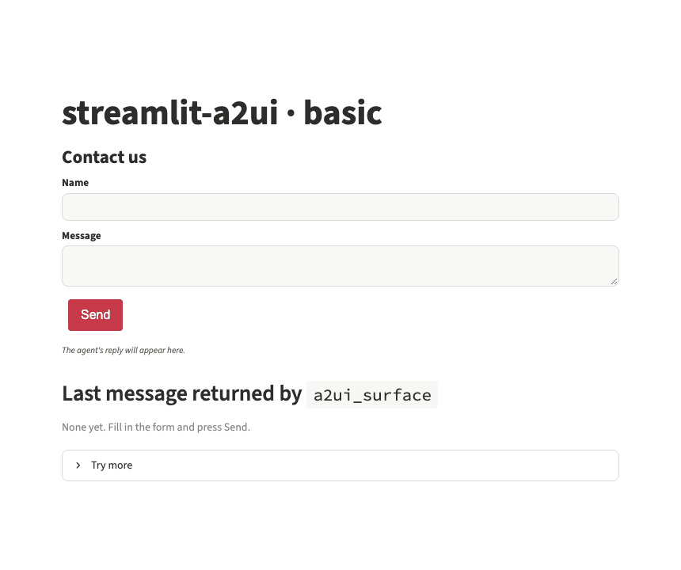

# streamlit-a2ui


Render [A2UI](https://a2ui.org) surfaces inside Streamlit apps.



*The form is an A2UI surface, drawn from the agent's messages by the official renderer. Press Send and `a2ui_surface` returns the action to Python (the JSON below); the scripted agent's reply updates the form in place.*

A2UI is a protocol in which an agent describes a user interface as JSON messages and a renderer draws it with a trusted catalog of components. `streamlit-a2ui` wraps the official web renderer (`@a2ui/react` and `@a2ui/web_core`) in a Streamlit Components v2 component. You pass it the agent's messages; it draws the surface, and it returns the user's actions so you can send them back to the agent.

It is for Python developers who already have an agent that speaks A2UI, or want one, and want to show its UI in a Streamlit app without writing frontend code.

## Status

Pre-1.0. `0.1.0` is the first release: try it and report problems, but expect the API and the supported versions to change before 1.0.

- A2UI **1.0** only, with the official basic catalog. 0.9.x and 0.8 are not supported.
- Streamlit >= 1.59 (Components v2). CI runs the floor (1.59) and the latest release; developed on 1.67.
- Python >= 3.10.
- Pinned to `@a2ui/react` and `@a2ui/web_core` 0.15.0. These upstream renderer packages are themselves pre-1.0 (see Security below for the overrides they need).

## Install

```bash
pip install streamlit-a2ui
```

This installs the latest final release. To try a release candidate, use `--pre` (pip), `--prerelease=allow` (uv) or an exact version. The wheel contains the built frontend, so no Node is needed.

Then run the example: download [`examples/basic_app.py`](https://github.com/josechudev/streamlit-a2ui/blob/master/examples/basic_app.py) and run `streamlit run basic_app.py`.

### From source

You need [uv](https://docs.astral.sh/uv/), Node 24 and npm.

```bash
git clone https://github.com/josechudev/streamlit-a2ui.git
cd streamlit-a2ui/streamlit_a2ui/frontend
npm install
npm run build
cd ../..
uv venv
uv pip install -e .
.venv/bin/streamlit run examples/basic_app.py
```

`npm run build` writes the frontend bundle into `streamlit_a2ui/frontend/build/` and generates `streamlit_a2ui/renderer_capabilities.json` and `streamlit_a2ui/THIRD_PARTY_LICENSES.txt`. Build it before installing, and again after changing the frontend. To build a wheel, run `uv build` after `npm run build`.

## Quickstart

Keep the agent's messages in an append-only list in `st.session_state`, pass the whole list on every run, and forward whatever comes back to your agent. This is a shortened [`examples/basic_app.py`](https://github.com/josechudev/streamlit-a2ui/blob/master/examples/basic_app.py), with a scripted function in place of a real agent:

```python
import streamlit as st

from streamlit_a2ui import a2ui_surface

CATALOG = "https://a2ui.org/specification/v1_0/catalogs/basic/catalog.json"


def initial_messages():
    return [
        {
            "version": "1.0",
            "createSurface": {"surfaceId": "contact", "catalogId": CATALOG},
        },
        {
            "version": "1.0",
            "updateComponents": {
                "surfaceId": "contact",
                "components": [
                    {
                        "id": "root",
                        "component": "Column",
                        "children": ["name_field", "send", "reply"],
                    },
                    {
                        "id": "name_field",
                        "component": "TextField",
                        "label": "Name",
                        "value": {"@path": "/name"},
                    },
                    {
                        "id": "send",
                        "component": "Button",
                        "child": "send_label",
                        "variant": "primary",
                        "action": {
                            "event": {
                                "name": "send_message",
                                "context": {"name": {"@path": "/name"}},
                            }
                        },
                    },
                    {"id": "send_label", "component": "Text", "text": "Send"},
                    {
                        "id": "reply",
                        "component": "Text",
                        "text": "The agent's reply will appear here.",
                    },
                ],
            },
        },
    ]


def scripted_agent(event):
    name = event["action"]["context"].get("name") or "there"
    return [
        {
            "version": "1.0",
            "updateComponents": {
                "surfaceId": "contact",
                "components": [
                    {"id": "reply", "component": "Text", "text": f"Thanks, {name}!"},
                ],
            },
        }
    ]


log = st.session_state.setdefault("a2ui_log", initial_messages())
event = a2ui_surface(log, key="contact")
if event is not None:
    st.session_state["last_event"] = event
    log.extend(scripted_agent(event))
    st.rerun()

st.json(st.session_state.get("last_event", {}))
```

When the user presses **Send**, `a2ui_surface` returns, once:

```json
{"version": "1.0",
 "action": {"name": "send_message", "surfaceId": "contact", "sourceComponentId": "send",
            "timestamp": "2026-11-17T06:41:12.836Z", "context": {"name": "Ada"}}}
```

The reply is appended to the log and the surface updates in place: text the user has typed but not sent is kept.

Take message shapes from the A2UI 1.0 specification. The installed `@a2ui/web_core` package has the schemas and examples under `node_modules/@a2ui/web_core/src/v1_0/schemas/`.

## Streaming

A keyed component can be called only once per script run, so a surface cannot be repainted in the middle of a run. To show an agent's messages as they arrive, put the component in a fragment that reruns on a timer and moves whatever the stream has produced into the log:

```python
@st.fragment(run_every=0.5)
def surface():
    log = st.session_state["a2ui_log"]
    log.extend(drain_new_messages())  # whatever your agent's stream produced
    event = a2ui_surface(log, key="stream")
    if event is not None:
        handle(event)  # only this fragment reran: handle the event here
        st.rerun(scope="fragment")


surface()
```

An action fired from a component inside a fragment reruns only that fragment, and the returned message is visible only there. Handle it inside the fragment, and use `st.rerun(scope="app")` when the rest of the page must change. [`examples/streaming_app.py`](https://github.com/josechudev/streamlit-a2ui/blob/master/examples/streaming_app.py) streams a dashboard over a few seconds, accepts an action during and after the stream, and switches the timer off when the stream ends.

Do not change the key to force a repaint: a new key mounts a new component and loses its state.

## Using it with a real agent

The package draws what an agent sends and returns what the user does; connecting the agent is your app's code. Pass `renderer_capabilities()` to the agent (with Google's [`a2ui-agent-sdk`](https://pypi.org/project/a2ui-agent-sdk/), under the `a2uiRendererCapabilities` key), run the agent's stream in a background thread or task that only appends complete A2UI messages to the log list, and draw the log with `a2ui_surface` inside `@st.fragment(run_every=...)` as above. Never call `st.*` from that thread. Send each message `a2ui_surface` returns back to the agent. This was checked with a minimal Google ADK agent built on `a2ui-agent-sdk` 0.12.0: an action round trip and a streamed response worked unchanged.

## API

### `a2ui_surface(messages, *, key) -> dict | None`

Renders the A2UI 1.0 messages in `messages` and returns at most one renderer-to-agent message per rerun.

- `messages`: the full, append-only list of agent-to-renderer messages. Pass the whole list on every run; the browser processes only the entries it has not seen. If the list gets shorter, or an entry it has already processed changes, the browser discards its state and replays the list from the start.
- `key`: a stable key. The surface keeps its state for as long as the key stays mounted.
- Returns the message produced since the last rerun, such as an `action` or a `callAgentFunction`, exactly as the A2UI 1.0 wire format defines it; otherwise `None`. Python does not inspect or validate messages.

### `renderer_capabilities() -> dict`

Returns the renderer's A2UI capabilities, to pass to your agent (for example in A2A metadata). It is generated from `@a2ui/web_core` when the frontend is built:

```python
{
    "1.0": {
        "supportedCatalogIds": [
            "https://a2ui.org/specification/v1_0/catalogs/basic/catalog.json"
        ]
    }
}
```

## Limitations

- A2UI 1.0 and the basic catalog only. No custom or inline catalogs.
- One renderer-to-agent message per rerun. A second message produced before the app reruns replaces the first: in testing, a double or triple click on a button returned only one action to Python. Do not rely on every click of a rapid burst reaching your agent.
- Errors stay in the browser. A message the renderer rejects, or an exception while one surface renders, shows a plain-text notice inside the component and a `console.warn`, and the other surfaces stay rendered; nothing is returned to Python, so your agent cannot see validation errors yet.
- The full log is sent to the browser on every rerun.
- Text typed into a surface but not sent is lost if the component remounts or the log is replaced.
- Streaming repaints at the fragment's interval, not per message.
- `callAgentFunction` times out after 30 seconds in `@a2ui/web_core`, so the agent's response must be appended to the log within that time.
- `@a2ui/web_core` adds a page-wide stylesheet (`color-scheme` and `--a2ui-*` defaults). It caused no visible change to Streamlit's widgets in testing.
- Only one build of the frontend can run on a page. After rebuilding it, reload the page.

## Security

The component runs in your app's page with no iframe. Read [docs/security.md](https://github.com/josechudev/streamlit-a2ui/blob/master/docs/security.md) for the security model, the dependency overrides and the known residual risks.

## Development

See [CONTRIBUTING.md](https://github.com/josechudev/streamlit-a2ui/blob/master/CONTRIBUTING.md) for how to build, test and release, with the full command list, and [docs/testing-playbook.md](https://github.com/josechudev/streamlit-a2ui/blob/master/docs/testing-playbook.md) has the manual checks. On every pull request CI runs the build, the unit tests, pytest, ruff and one Playwright browser test on Python 3.10 with Streamlit 1.59 and on Python 3.13 with the latest Streamlit, then builds the wheel and sdist once and runs the browser test against the installed wheel. The architecture is summarised in [docs/architecture.md](https://github.com/josechudev/streamlit-a2ui/blob/master/docs/architecture.md), design decisions are in [docs/adr/](https://github.com/josechudev/streamlit-a2ui/tree/master/docs/adr), and changes are in [CHANGELOG.md](https://github.com/josechudev/streamlit-a2ui/blob/master/CHANGELOG.md).

## License

Apache-2.0. See [LICENSE](https://github.com/josechudev/streamlit-a2ui/blob/master/LICENSE). The wheel bundles third-party JavaScript; their licenses are in `streamlit_a2ui/THIRD_PARTY_LICENSES.txt`, generated by `npm run build` and also listed as a license file in the package metadata.
