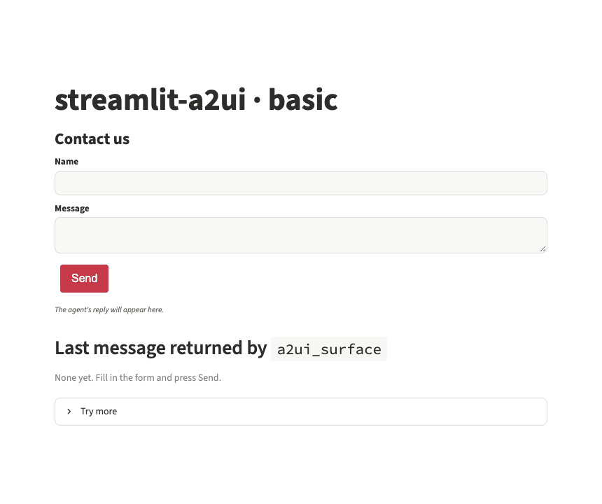

# M4 drafts: release notes, listings and posts

Drafted 2026-11-18 by Claude Code for the owner, who creates, opens and publishes each of them (`docs/history/handoff-m4.md`, steps 11–17). Nothing here has been posted.

## 1. GitHub release `v0.1.0`

Create it on the existing tag, with no assets (owner's decision): PyPI is the one source of files.

```bash
gh release create v0.1.0 --verify-tag --title "streamlit-a2ui 0.1.0" --notes-file release-notes.md
```

`release-notes.md`:

````markdown
Render [A2UI](https://a2ui.org) surfaces in Streamlit apps. An agent describes a user interface as A2UI messages; `streamlit-a2ui` draws it with the official web renderer and returns the user's actions to Python.

```bash
pip install streamlit-a2ui
```

**First release.** Pre-1.0: the API and the supported versions may change before 1.0.

- A2UI **1.0** only, with the official basic catalog.
- Python 3.10 or newer, Streamlit 1.59 or newer (CI runs 1.59 and the latest).
- Built on the pinned `@a2ui/react` and `@a2ui/web_core` 0.15.0, which are themselves pre-1.0.
- API: `a2ui_surface(messages, *, key) -> dict | None` and `renderer_capabilities() -> dict`.

### Changes since 0.1.0rc1

- **Fixed:** the first page load in a new environment no longer waits 20 seconds or more for the surface (Streamlit's dataframe check imported pandas and pyarrow on the first call). Measured: about 23 s to under 1 s.
- README: a plain `pip install streamlit-a2ui`, and a GIF that ends on the updated surface.

### Known limitations

- At most one renderer-to-agent message per rerun: a double click returns one action.
- Renderer errors stay in the browser (a notice and a `console.warn`); your agent does not see them yet.
- `callAgentFunction` times out after 30 seconds in `@a2ui/web_core`.

### Security

- `dompurify` is overridden to 3.4.18 inside `@a2ui/markdown-it`, which pins a release with open advisories ([a2ui-project/a2ui#4278](https://github.com/a2ui-project/a2ui/issues/4278)); the `@a2ui/web_core` peer range is overridden too ([#4059](https://github.com/a2ui-project/a2ui/issues/4059)).
- `@a2ui/web_core` adds a page-wide stylesheet ([#4279](https://github.com/a2ui-project/a2ui/issues/4279)).
- Accepted residual risk: the `zod` 3.x advisory GHSA-mrhx-c7xc-m3w5, which has no 3.x fix.
- Details: [docs/security.md](https://github.com/josechudev/streamlit-a2ui/blob/master/docs/security.md).

### Provenance

Published to [PyPI](https://pypi.org/project/streamlit-a2ui/0.1.0/) by [release run 44356056432](https://github.com/josechudev/streamlit-a2ui/actions/runs/44356056432) through Trusted Publishing, with PEP 740 attestations. Full changelog: [CHANGELOG.md](https://github.com/josechudev/streamlit-a2ui/blob/master/CHANGELOG.md).
````

## 2. Listing: A2UI community projects page

Repository `a2ui-project/a2ui`, file `docs/site/src/content/docs/ecosystem/renderers.mdx`, table "Community renderers". Rechecked 2026-11-18: fork, the Google CLA (signed by the owner), one row, a pull request against `main`, then a post in GitHub Discussions. Listing criteria (open licence, documented protocol versions, core components, install instructions and a runnable example, active maintenance) are met.

Insert this row after the `lbb00/a2ui-miniprogram` row (the last `v1.0` renderer). It is padded to the table's current column widths, so the diff is one line; the edited file passes `prettier@3.8.4 --config .prettierrc --check`, the version and config `./scripts/fix_format.sh` uses. Commit it with the e-mail address the CLA was signed with.

```text
| **[josechudev/streamlit-a2ui](https://github.com/josechudev/streamlit-a2ui)**<br />(`streamlit-a2ui`) · [PyPI](https://pypi.org/project/streamlit-a2ui/)                                                                             | Streamlit (Python, Web)                                   | `v1.0`           | Active       | Streamlit component wrapping the official `@a2ui/react` renderer; actions return to Python.                       |
```

Pull request title: `docs: add streamlit-a2ui to community renderers`

Pull request description:

```markdown
Adds [streamlit-a2ui](https://github.com/josechudev/streamlit-a2ui) to the community renderers table.

- **What:** a Streamlit component (Python) that renders A2UI surfaces by wrapping the official `@a2ui/react` and `@a2ui/web_core` (0.15.0), and returns renderer-to-agent messages (actions, `callAgentFunction`) to Python.
- **Protocol:** v1.0 only, basic catalog.
- **Install:** `pip install streamlit-a2ui` ([PyPI](https://pypi.org/project/streamlit-a2ui/)); Apache-2.0.
- **Verification:** CI on Python 3.10 and 3.13 with a Playwright browser test; checked against an ADK agent built with `a2ui-agent-sdk` 0.12.0 (action round trip and streamed response). A GIF of the basic example is in the README.

Formatted with `./scripts/fix_format.sh --check` (Prettier 3.8.4); the diff is one row.
```

## 3. Listing: Streamlit component gallery

Repository `streamlit/gallery`, new file `components/registry/components/streamlit-a2ui.json`. Rechecked 2026-11-18: fork, add the file, pull request; CI validates it; the gallery refreshes weekly after a merge. No existing entry mentions `streamlit-a2ui`.

The file validates against the registry's `component.schema.json` (checked locally with `jsonschema`, Draft 2020-12, format checks on) and meets the policy rules: HTTPS only, a stable image URL (not signed, not `camo`), under 50 KB (619 bytes). A GIF as `media.image` has precedent in the registry.

```json
{
  "schemaVersion": 1,
  "title": "A2UI Surface",
  "author": {
    "github": "josechudev",
    "displayName": "josechudev"
  },
  "links": {
    "github": "https://github.com/josechudev/streamlit-a2ui",
    "pypi": "streamlit-a2ui",
    "demo": null,
    "docs": "https://github.com/josechudev/streamlit-a2ui#readme"
  },
  "media": {
    "image": "https://raw.githubusercontent.com/josechudev/streamlit-a2ui/master/docs/images/basic-example.gif"
  },
  "install": {
    "pip": "pip install streamlit-a2ui"
  },
  "governance": {
    "enabled": true,
    "notes": null
  },
  "categories": ["LLMs", "Integrations"]
}
```

Pull request title: `Add streamlit-a2ui (A2UI Surface)`

Pull request description:

```markdown
Adds `streamlit-a2ui`, a component that renders [A2UI](https://a2ui.org) surfaces (agent-generated UI, protocol v1.0) with the official web renderer and returns the user's actions to Python.

- Repo: https://github.com/josechudev/streamlit-a2ui (Apache-2.0)
- PyPI: `streamlit-a2ui` (Components v2; Streamlit >= 1.59)
```

## 4. Post: Streamlit forum

Category: check on the day; "Custom Components" if it still exists, otherwise "Show the Community!".

Title: `streamlit-a2ui: render A2UI agent interfaces in Streamlit`

````markdown
Hi all. I've released **streamlit-a2ui**, a component that renders [A2UI](https://a2ui.org) surfaces in a Streamlit app.

A2UI is an open protocol from Google in which an agent describes a user interface as JSON messages (forms, cards, buttons, lists from a trusted catalog) and a renderer draws it. `streamlit-a2ui` wraps the official A2UI web renderer in a Components v2 component, so you pass it the agent's messages and get the user's actions back in Python:

```python
from streamlit_a2ui import a2ui_surface

log = st.session_state.setdefault("a2ui_log", [])
event = a2ui_surface(log, key="main")
if event:
    log.extend(my_agent.send(event))
    st.rerun()
```



- `pip install streamlit-a2ui` (Streamlit 1.59+, Python 3.10+)
- Streaming works with `@st.fragment(run_every=...)`; there's an example in the repo.
- Checked with a Google ADK agent using `a2ui-agent-sdk`: an action round trip and a streamed response.
- The surface follows your Streamlit theme, light and dark.

It's pre-1.0: A2UI 1.0 and the basic catalog only, and one renderer-to-agent message per rerun. Feedback and issues are welcome: https://github.com/josechudev/streamlit-a2ui
````

## 5. Post: A2UI GitHub Discussions

Repository `a2ui-project/a2ui`, category "Show and tell".

Title: `streamlit-a2ui: an A2UI 1.0 renderer for Streamlit (Python)`

```markdown
I've built **[streamlit-a2ui](https://github.com/josechudev/streamlit-a2ui)**, a Streamlit component that renders A2UI 1.0 surfaces by wrapping the official `@a2ui/react` and `@a2ui/web_core` (0.15.0) in a Streamlit Components v2 component. Python apps pass in the agent's messages and receive renderer-to-agent messages (actions and `callAgentFunction`) back.


- `pip install streamlit-a2ui`; Apache-2.0.
- v1.0 and the basic catalog only; `renderer_capabilities()` is generated from `web_core` and accepted unchanged by `a2ui-agent-sdk` (`a2uiRendererCapabilities`).
- Checked with an ADK agent on `a2ui-agent-sdk` 0.12.0: an action round trip and a streamed response, with no renderer changes.
- Validation runs with `RELAXED_VALIDATION` plus `allowUnknownElements: false`, so surfaces can stream in out of order but unknown component types are rejected.

While building it I filed #4278 (DOMPurify pin in `@a2ui/markdown-it`) and #4279 (the page-wide stylesheet from `web_core`), and commented on #4059 (the `markdown-it` peer range); the package carries npm overrides for the first and third until upstream releases fixes.

I've also opened a pull request adding it to the community renderers table: <link once opened>.
```
